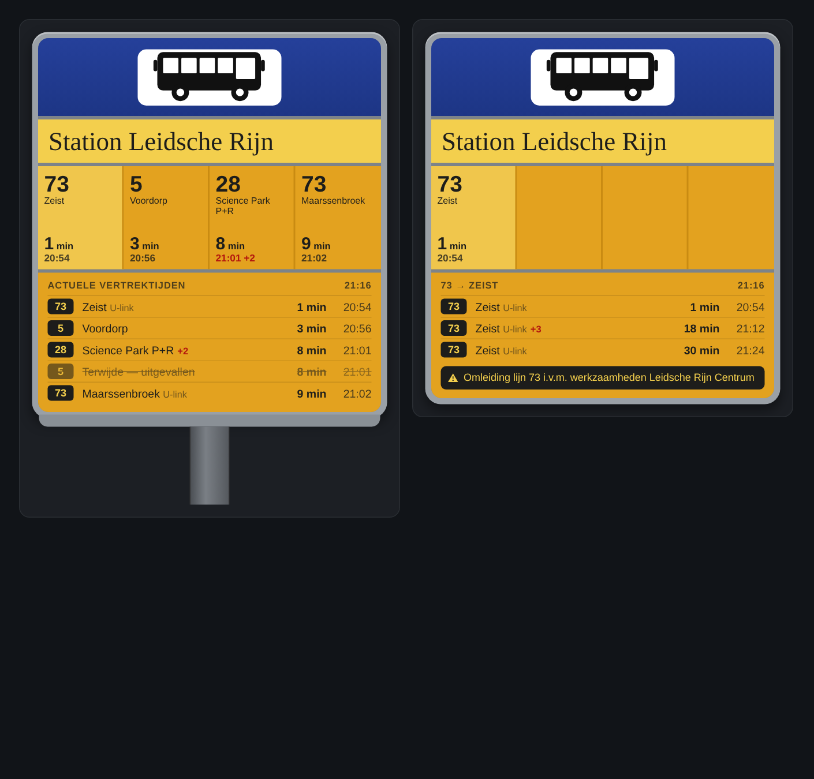

# Bushalte Card

A Lovelace card that shows a stop from the **Bus vertrektijden** integration as a Dutch bus stop sign (*haltepaal*): the blue head with the bus pictogram, the yellow name board, orange line panels with the next departure in minutes and as a time, a live departures panel and the pole.



## Features

- Line panels (up to 4) with line number, direction, **minutes until departure** and the **expected time**; delays in red (`+3`), the panel blinks when the bus leaves within a minute.
- Live departures panel with line badge, direction, route name (e.g. *U-link*), minutes and time; cancelled trips are struck through.
- Stop alerts and trip alerts as a black bar.
- Counts down locally between updates.
- Choose the panels yourself (e.g. only *line 73 towards Zeist*) or let the card pick them automatically.
- Optional pole, route names and city name.
- Visual editor; Dutch and English labels.

## Requirements

The [Bus vertrektijden](https://github.com/nosehook/busvertrektijden-ha) integration (the original [kerstenremco/busvertrektijden-ha](https://github.com/kerstenremco/busvertrektijden-ha) works too; the fork adds exact expected times and delays).

## Installation

[](https://my.home-assistant.io/redirect/marketplace_repository/?owner=nosehook&repository=bushalte-card&category=plugin)

<!-- ha-marketplace:exclude-start -->
### Marketplace (Home Assistant 2026.11 and later)
1. Click the button above, or open the **Marketplace** in Home Assistant and add `https://github.com/nosehook/bushalte-card` by its link, category **Dashboard**.
2. Install **Bushalte Card** and reload your browser. The Marketplace adds the dashboard resource for you.

### HACS (Home Assistant before 2026.11)
Add `https://github.com/nosehook/bushalte-card` as a custom repository, category **Dashboard**, and install **Bushalte Card**.

### Manual
1. Copy `bushalte-card.js` to `/config/www/`.
2. Settings → Dashboards → ⋮ → Resources → add `/local/bushalte-card.js` as a **JavaScript module**.
<!-- ha-marketplace:exclude-end -->

## Configuration

Add the card from the card picker and use the visual editor, or in YAML:

```yaml
type: custom:bushalte-card
entity: sensor.bus_stop_utrecht_station_leidsche_rijn
tiles:
  - line: "73"
    direction: Zeist
```

| Option | Default | Description |
|---|---|---|
| `entity` | – | The *Bushalte …* sensor of the stop |
| `name` | stop name | Text on the yellow name board |
| `tiles` | automatic | Up to 4 panels, each with `line` and optional `direction` (also `tile1_line`, `tile1_direction` … `tile4_*`) |
| `rows` | `5` | Departures in the bottom panel (`0` hides it) |
| `rows_follow_tiles` | `true` | With panels chosen: only show departures of those lines/directions |
| `show_pole` | `true` | Draw the pole under the sign |
| `show_trip` | `true` | Show route names such as *U-link* |
| `strip_city` | `true` | Leave out the city before the comma in the stop name |
| `language` | `nl` | `nl` or `en` |

## License

MIT
